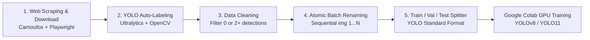

<p align="center">
  <a href="README.md"><b>🇺🇸 English</b></a> &nbsp;|&nbsp;
  <a href="README.tr.md">🇹🇷 Türkçe</a>
</p>

# 🚗 YOLO Plate Detection Pipeline & Desktop GUI

[](https://www.python.org/)
[](https://doc.qt.io/qtforpython-6/)
[](https://github.com/ultralytics/ultralytics)
[](https://github.com/daijro/camoufox)
[](https://colab.research.google.com/github/Emingrgl/Yolo_Plate_Detection/blob/main/train_colab.ipynb)
[](https://github.com/Emingrgl/Yolo_Plate_Detection/releases)

An all-in-one, production-ready computer vision pipeline and desktop application for **License Plate Detection**. It seamlessly unifies automated web scraping, anti-detect browser automation, AI auto-labeling, strict data quality filtration, collision-safe file indexing, and standard YOLO **Train / Val / Test** dataset splitting inside a responsive **PySide6 (Qt)** dark-themed GUI.

Also includes ready-to-run **Google Colab GPU training** scripts and Jupyter Notebooks.

---

## 📋 Table of Contents
- [✨ Key Features](#-key-features)
- [🔄 5-Stage Data Pipeline Architecture](#-5-stage-data-pipeline-architecture)
- [💻 Installation](#-installation)
- [🚀 Running the Application](#-running-the-application)
- [☁️ Training on Google Colab (GPU)](#️-training-on-google-colab-gpu)
- [📁 Dataset Directory Structure](#-dataset-directory-structure)
- [⚙️ Configuration Parameters](#️-configuration-parameters)
- [📦 Releases](#-releases)
- [📄 Contributing & License](#-contributing--license)

---

## ✨ Key Features

- **Modern Dark-Themed GUI:** Built with PySide6 (Qt), featuring clean inputs, step toggles, and live log streaming.
- **Non-blocking Multithreaded Execution:** Powered by `QThread`, `QMutex`, and `QWaitCondition` so heavy web scraping and model inference never freeze the UI.
- **Interactive Cloudflare / Bot Bypass:** Built-in interactive browser pause mechanism allows users to pass verification checks manually before automated crawling resumes.
- **Automated AI Labeling:** Leverages Ultralytics YOLO models to automatically detect license plates, generate normalized bounding box annotations (`.txt`), and export visual confirmation overlays.
- **Data Quality Sanitizer:** Automatically filters out invalid samples (0 detections / empty frames) or ambiguous multi-detection images (2+ plates).
- **Collision-Safe Atomic Renaming:** Two-stage batch renamer with UUID intermediate hashing ensures sequential indexing (`img(1).jpg`, `img(2).jpg`, ...) without accidental file overwriting.
- **YOLOv8 / YOLO11 Ready Dataset Splitter:** Shuffles and partitions images and labels into standard `train`, `val`, and `test` subdirectories with customizable ratios.

---

## 🔄 5-Stage Data Pipeline Architecture



### 1. Web Scraping & Stealth Image Harvesting
- Uses **Camoufox (Anti-detect Firefox)** and **Playwright** to bypass bot mitigation systems and crawl high-resolution vehicle and license plate records.
- Persists session state in `durum.json` and annotations in `notlar.txt`, enabling resumes if interrupted.

### 2. YOLO Auto-Annotation (Pseudo-labeling)
- Employs a pre-trained base model (`.pt`) to detect plate coordinates across raw images.
- Produces normalized YOLO `.txt` files (`<class_id> <x_center> <y_center> <width> <height>`).
- Saves visual inspection images with bounding box overlays in `drawn_folder`.

### 3. Strict Dataset Sanitization
- Ensures clean, single-plate training instances.
- Images with 0 detections (empty / missed plates) or multiple detections ($\ge 2$ plates) are automatically pruned along with corresponding annotation files.

### 4. Safe Batch Renaming (Zero-Collision)
- Synchronizes raw images, visual overlays, and `.txt` labels into standard `img(N)` scheme.
- Utilizes an intermediate `__temp_<uuid>` state to prevent name collisions on Windows/Linux filesystems.

### 5. Train / Val / Test Partitioning
- Shuffles the sanitized dataset and distributes pairs into `images/` and `labels/` for `train`, `val`, and `test` splits (e.g., 70% / 20% / 10%).

---

## 💻 Installation

### Prerequisites
- Python 3.9+
- Git

### 1. Clone the Repository
```bash
git clone https://github.com/Emingrgl/Yolo_Plate_Detection.git
cd Yolo_Plate_Detection
```

### 2. Create and Activate Virtual Environment
```bash
# Windows
python -m venv .venv
.venv\Scripts\activate

# Linux / macOS
python3 -m venv .venv
source .venv/bin/activate
```

### 3. Install Dependencies
```bash
pip install -r requirements.txt
```

> **Note (Playwright & Camoufox Binaries):** Download browser engines if running Step 1 for the first time:
> ```bash
> playwright install
> camoufox fetch
> ```

---

## 🚀 Running the Application

Launch the desktop interface:

```bash
python APP_V1.py
```

### Workflow Steps:
1. **Choose Working Directory:** Select your project base directory.
2. **Select Steps to Execute:** Check any combination of steps 1 through 5 (e.g., run only Steps 2 & 3 or all 5 sequentially).
3. **Configure Settings:**
   - URL, page counts, delay times (Step 1)
   - Model weights path, confidence threshold, image size (Step 2)
   - Split ratios for train/validation (Step 5)
4. **Click "İŞLEMİ BAŞLAT" (Start Process):** Monitor live execution logs in the right panel.

---

## ☁️ Training on Google Colab (GPU)

You can train custom YOLOv8 / YOLO11 plate detection models for free on Google Colab's **T4 GPU** using the provided interactive notebook:

[](https://colab.research.google.com/github/Emingrgl/Yolo_Plate_Detection/blob/main/train_colab.ipynb)

### Colab Quickstart:

1. Click the **"Open In Colab"** badge above or open [`train_colab.ipynb`](train_colab.ipynb).
2. Set runtime hardware to **T4 GPU** (`Runtime > Change runtime type > T4 GPU`).
3. Upload your partitioned `dataset.zip` created in Step 5:
   ```python
   !unzip -q /content/dataset.zip -d /content/dataset
   ```
4. Install Ultralytics and start training:
   ```python
   !pip install -q ultralytics
   from ultralytics import YOLO

   model = YOLO('yolov8n.pt')  # or yolo11n.pt, yolov8s.pt

   results = model.train(
       data='/content/data.yaml',
       epochs=50,
       imgsz=640,
       batch=16,
       device=0,
       project='plate_detector',
       name='yolov8_run'
   )
   ```
5. Evaluate metrics (mAP50, precision, recall) and export weights:
   ```python
   best_model = YOLO('/content/plate_detector/yolov8_run/weights/best.pt')
   best_model.export(format='onnx')
   ```

---

## 📁 Dataset Directory Structure

Upon completing Step 5, the following YOLO-compliant directory structure is generated:

```
dataset/
├── data.yaml
├── images/
│   ├── train/       # Training images (img(1).jpg, img(2).jpg, ...)
│   ├── val/         # Validation images
│   └── test/        # Test images
└── labels/
    ├── train/       # Bounding box labels (img(1).txt, ...)
    ├── val/         # Validation labels
    └── test/        # Test labels
```

Example annotation file format:
```
0 0.485123 0.612845 0.182410 0.054320
```
*(Normalized values: `<class_id> <x_center> <y_center> <width> <height>`)*

---

## ⚙️ Configuration Parameters

Key settings configurable via the GUI **Parametreler** tab:

| Parameter | Default | Description |
|---|---|---|
| `raw_folder` | `arabalar` | Directory storing raw harvested vehicle images |
| `labels_folder` | `etiketler` | Directory storing YOLO `.txt` annotation files |
| `drawn_folder` | `etiketlenmis_arabalar` | Visual detection overlay verification images |
| `s2_conf` | `0.25` | Confidence threshold for YOLO auto-labeling |
| `s2_imgsz` | `640` | Inference resolution for auto-labeling |
| `s5_train_ratio` | `0.70` | Percentage allocated to training set |
| `s5_val_ratio` | `0.20` | Percentage allocated to validation set (remainder to test) |

---

## 📦 Releases

Find pre-configured packages, changelogs, and release assets under [GitHub Releases](https://github.com/Emingrgl/Yolo_Plate_Detection/releases):

- **[v1.0.0](https://github.com/Emingrgl/Yolo_Plate_Detection/releases/tag/v1.0.0)**:
  - Initial public release of PySide6 GUI pipeline.
  - Multi-stage scraping, labeling, cleaning, and dataset splitter.
  - Interactive Colab GPU training notebook and comprehensive documentation.

---

## 📄 Contributing & License

Contributions, issues, and feature requests are welcome! Feel free to check the [issues page](https://github.com/Emingrgl/Yolo_Plate_Detection/issues).

Author: **[Emin Görgülü](https://github.com/Emingrgl)**
