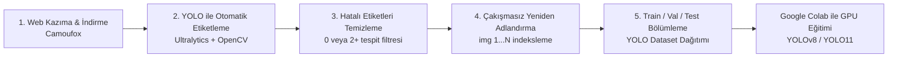

<p align="center">
  <a href="README.md">🇺🇸 English</a> &nbsp;|&nbsp;
  <a href="README.tr.md"><b>🇹🇷 Türkçe</b></a>
</p>

# 🚗 YOLO Plate Detection Pipeline & GUI (Plaka Tespit Hattı)

[](https://www.python.org/)
[](https://doc.qt.io/qtforpython-6/)
[](https://github.com/ultralytics/ultralytics)
[](https://github.com/daijro/camoufox)
[](https://colab.research.google.com/github/Emingrgl/Yolo_Plate_Detection/blob/main/train_colab.ipynb)
[](https://github.com/Emingrgl/Yolo_Plate_Detection/releases)

Araç plakası tespiti (**License Plate Detection**) için web scraping'den başlayarak otomatik etiketlemeye, veri temizlemeye, dosya indekslemeye ve nihayetinde YOLO formatında **Train / Val / Test** veri seti bölmeye kadar tüm süreci tek bir modern grafik arayüz (GUI) altında toplayan uçtan uca veri hazırlama ve eğitim hattı.

---

## 📋 İçindekiler
- [✨ Özellikler](#-özellikler)
- [🔄 5 Aşamalı Veri İşleme Hattı](#-5-aşamalı-veri-işleme-hattı)
- [💻 Kurulum](#-kurulum)
- [🚀 Uygulamanın Çalıştırılması](#-uygulamanın-çalıştırılması)
- [☁️ Google Colab ile Model Eğitimi](#️-google-colab-ile-model-eğitimi)
- [📁 Veri Seti Dizin Yapısı](#-veri-seti-dizin-yapısı)
- [⚙️ Yapılandırma ve Parametreler](#️-yapılandırma-ve-parametreler)
- [📦 Sürümler (Releases)](#-sürümler-releases)
- [📄 Lisans & Katkı](#-lisans--katkı)

---

## ✨ Özellikler

- **Modern & Şık Dark-Theme Arayüz:** PySide6 (Qt) ile geliştirilmiş, kullanıcı dostu ve duyarlı grafik arayüz.
- **Donmayan Arka Plan İşlemleri:** `QThread`, `QMutex` ve `QWaitCondition` mimarisi sayesinde uzun süren scraping ve YOLO tahminleri arayüzü kilitlemez.
- **Etkileşimli Doğrulama Desteği:** Cloudflare / Bot korumalarını aşmak için tarayıcı açıldığında kullanıcı onayını bekleyen akıllı duraklatma mekanizması.
- **Otomatik YOLO Etiketleme:** Mevcut bir YOLO ağırlığı ile ham görselleri saniyeler içinde tespit edip normalize edilmiş (`xywhn`) `.txt` dosyaları oluşturma.
- **Kusursuz Veri Filtreleme:** Çoklu tespitleri (birden fazla plaka) ve boş görselleri otomatik tespit edip veri kümesinden temizleme.
- **Çakışmasız Toplu Yeniden Adlandırma:** UUID tabanlı çift aşamalı adlandırma ile dosya üzerine yazılma riskini tamamen ortadan kaldıran sıralı indeksleme (`img(1).jpg`, `img(2).jpg` vb.).
- **YOLOv8 / YOLO11 Uyumlu Veri Seti Bölücü:** Train, Validation ve Test klasörlerini otomatik oluşturup görselleri ve etiketleri paylaştırma.

---

## 🔄 5 Aşamalı Veri İşleme Hattı



### 1. Adım: Veri Kazıma & Görsel İndirme (Web Scraping)
- **Camoufox (Anti-detect Browser)** ve **Playwright** entegrasyonu ile tespit edilmeden yüksek çözünürlüklü plaka görselleri ve araç bilgileri indirilir.
- İlerleme durumu `durum.json` ve `notlar.txt` dosyalarına anlık kaydedilir; işlem kesilse bile kaldığı yerden devam edebilir.

### 2. Adım: YOLO ile Otomatik Etiketleme (Auto-labeling)
- Önceden eğitilmiş bir temel model (`.pt`) kullanılarak ham araç görselleri taranır.
- Tespit edilen plakaların etiketleri YOLO formatında (`class x_center y_center width height`) `.txt` olarak üretilir.
- Görsel doğrulama için kutucuk çizilmiş önizleme görselleri de `drawn` klasörüne aktarılır.

### 3. Adım: Hatalı Etiket Kontrolü ve Temizliği (Data Cleansing)
- Kaliteli bir plaka eğitim kümesi için **tam olarak 1 plaka** içeren görseller hedeflenir.
- 0 tespit içeren (boş) veya 2 ve daha fazla plaka içeren karmaşık/hatalı görseller ve ilişkili TXT dosyaları otomatik silinir.

### 4. Adım: Eşzamanlı Yeniden Adlandırma (Safe Batch Renamer)
- Görseller, etiketli çizimler ve `.txt` dosyaları senkronize olarak `img(1)`, `img(2)` formatına dönüştürülür.
- Geçici UUID (`__temp_<uuid>`) aşaması sayesinde dosya çakışmaları ve veri kaybı önlenir.

### 5. Adım: Train / Val / Test Ayırma
- Belirlediğiniz oranlara göre (Örn: `%70 Train`, `%20 Val`, `%10 Test`) veriler karıştırılır (`shuffle`) ve YOLO standart dizin formatında klasörlenir.

---

## 💻 Kurulum

### Gereksinimler
- Python 3.9 veya üstü
- Git

### 1. Depoyu Klonlayın
```bash
git clone https://github.com/Emingrgl/Yolo_Plate_Detection.git
cd Yolo_Plate_Detection
```

### 2. Sanal Ortam Oluşturun (Önerilen)
```bash
# Windows
python -m venv .venv
.venv\Scripts\activate

# Linux / macOS
python3 -m venv .venv
source .venv/bin/activate
```

### 3. Bağımlılıkları Yükleyin
```bash
pip install -r requirements.txt
```

> **Not (Camoufox & Playwright):** Tarayıcı kütüphanesinin tarayıcı ikililerini indirmesi için:
> ```bash
> playwright install
> camoufox fetch
> ```

---

## 🚀 Uygulamanın Çalıştırılması

Ana arayüzü başlatmak için:

```bash
python APP_V1.py
```

### Arayüz Kullanım Adımları:
1. **Çalışma Dizini Seçin:** Proje dosyalarınızın tutulacağı ana klasörü belirleyin.
2. **Çalıştırılacak Adımları Seçin:** İhtiyacınıza göre 1'den 5'e kadar tüm adımları veya yalnızca belirli adımları (örneğin sadece 2. ve 3. adımı) işaretleyin.
3. **Ayarları Düzenleyin:**
   - Sayfa aralığı, URL ve gecikme süresi (1. Adım)
   - Model ağırlık yolu (`.pt`), güven eşiği (`conf`) ve resim boyutu (2. Adım)
   - Train / Val oranları (5. Adım)
4. **"İŞLEMİ BAŞLAT"** butonuna basın. Canlı log akışını sağ panelden takip edin.

---

## ☁️ Google Colab ile Model Eğitimi

Pipeline'ın 5. adımında oluşturduğu veri setini Google Colab'in **ücretsiz T4 GPU** gücüyle eğitmek için depomuzdaki [`train_colab.ipynb`](train_colab.ipynb) not defterini kullanabilirsiniz.

[](https://colab.research.google.com/github/Emingrgl/Yolo_Plate_Detection/blob/main/train_colab.ipynb)

### Colab Üzerinde Adım Adım Eğitim:

#### 1. Colab Not Defterini Açın
Yukarıdaki **"Open in Colab"** butonuna tıklayın veya `train_colab.ipynb` dosyasını [Google Colab](https://colab.research.google.com)'e yükleyin. Menüden **Çalışma Zamanı > Çalışma zamanı türünü değiştir > Donanım Hızlandırıcı: T4 GPU** seçildiğinden emin olun.

#### 2. Kütüphaneleri Yükleyin
```python
!pip install -q ultralytics
import ultralytics
ultralytics.checks()
```

#### 3. Veri Setini Yükleyin
Uygulamanın oluşturduğu `dataset` klasörünü `dataset.zip` olarak sıkıştırıp Colab ortamına yükleyin:
```python
!unzip -q /content/dataset.zip -d /content/dataset
```

#### 4. Yapılandırma Dosyası (`data.yaml`) Oluşturun
```python
import yaml

config = {
    'path': '/content/dataset',
    'train': 'images/train',
    'val': 'images/val',
    'test': 'images/test',
    'names': {0: 'plate'}
}

with open('/content/data.yaml', 'w') as f:
    yaml.dump(config, f)
```

#### 5. Model Eğitimini Başlatın
```python
from ultralytics import YOLO

# Hafif ve hızlı bir başlangıç için YOLOv8n veya yeni YOLO11n kullanabilirsiniz:
model = YOLO('yolov8n.pt')

results = model.train(
    data='/content/data.yaml',
    epochs=50,          # Veri boyutunuza göre 50-100 epoch idealdir
    imgsz=640,          # Plaka tespiti için 640 standart çözünürlük
    batch=16,           # GPU belleğine göre 16 veya 32
    device=0,           # GPU kullanımı
    project='plate_detector',
    name='yolo_plate_run'
)
```

#### 6. Değerlendirme & Test
Eğitilen en iyi ağırlık (`weights/best.pt`) ile test kümesinde tahmin yapın ve metrikleri inceleyin:
```python
best_model = YOLO('/content/plate_detector/yolo_plate_run/weights/best.pt')

# Test tahminleri
best_model.predict(source='/content/dataset/images/test', conf=0.3, save=True)

# Ağırlığı bilgisayarınıza indirin
from google.colab import files
files.download('/content/plate_detector/yolo_plate_run/weights/best.pt')
```

---

## 📁 Veri Seti Dizin Yapısı

İşlem tamamlandığında 5. adım şu standart YOLO klasör yapısını üretir:

```
dataset/
├── data.yaml
├── images/
│   ├── train/       # Eğitim görselleri (img(1).jpg, ...)
│   ├── val/         # Doğrulama görselleri
│   └── test/        # Test görselleri
└── labels/
    ├── train/       # YOLO etiketleri (img(1).txt, ...)
    ├── val/         # Doğrulama etiketleri
    └── test/        # Test etiketleri
```

Her bir `.txt` dosyasının içeriği:
```
0 0.485123 0.612845 0.182410 0.054320
```
*(Sınıf ID, X_Center, Y_Center, Width, Height - 0-1 normalize edilmiş)*

---

## ⚙️ Yapılandırma ve Parametreler

Arayüzdeki **Parametreler** sekmesinden özelleştirebileceğiniz başlıca ayarlar:

| Parametre | Varsayılan | Açıklama |
|---|---|---|
| `raw_folder` | `arabalar` | Ham indirilen görsellerin saklandığı klasör |
| `labels_folder` | `etiketler` | YOLO formatındaki `.txt` dosyaları klasörü |
| `drawn_folder` | `etiketlenmis_arabalar` | Tespit kutucukları çizilmiş kontrol görselleri |
| `s2_conf` | `0.25` | 2. Adım için YOLO güvenilirlik (confidence) eşiği |
| `s2_imgsz` | `640` | Model tahmin çözünürlüğü |
| `s5_train_ratio` | `0.70` | Eğitim verisi yüzdesi |
| `s5_val_ratio` | `0.20` | Doğrulama verisi yüzdesi (Kalan %10 Test) |

---

## 📦 Sürümler (Releases)

En son kararlı sürümü ve güncellemeleri [GitHub Releases](https://github.com/Emingrgl/Yolo_Plate_Detection/releases) sayfasından indirebilirsiniz:

- **[v1.0.0](https://github.com/Emingrgl/Yolo_Plate_Detection/releases/tag/v1.0.0)** - İlk resmi sürüm:
  - PySide6 GUI tabanlı 5 aşamalı pipeline
  - Camoufox entegreli web scraper
  - Ultralytics YOLO otomatik etiketleme & filtreleme motoru
  - Google Colab GPU eğitim şablonu ve rehberi

---

## 📄 Lisans & Katkı

Bu proje açık kaynaklıdır. Geliştirme önerileri veya hata bildirimleri için Issue açabilir veya Pull Request gönderebilirsiniz.

Geliştirici: [Emin Görgülü](https://github.com/Emingrgl)
